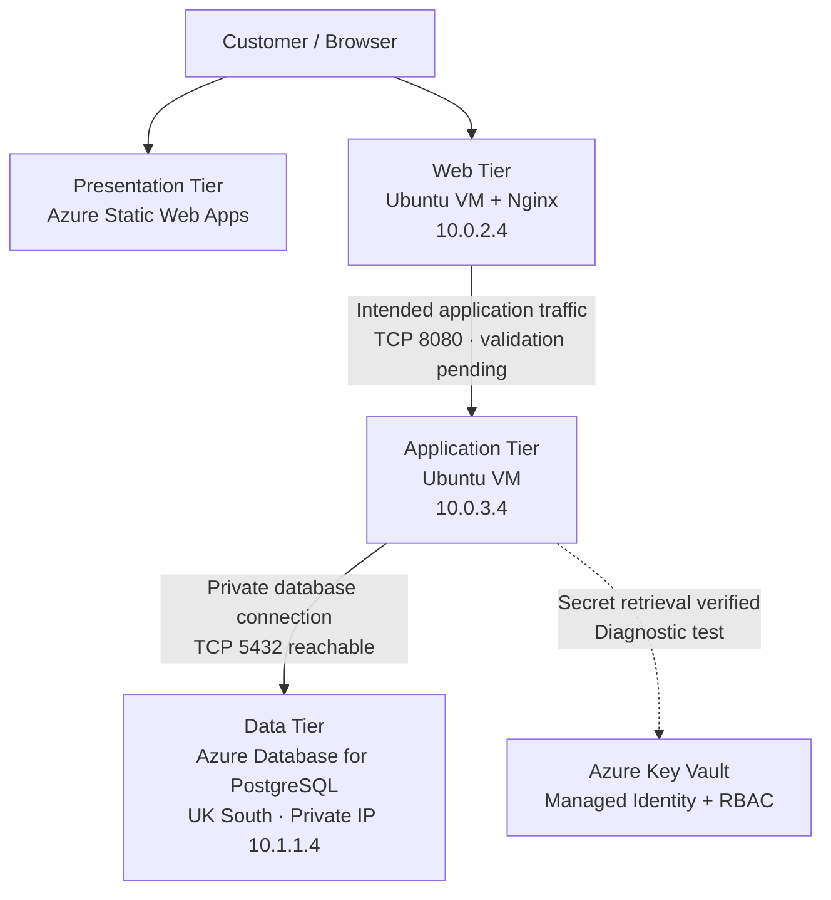

# High-Availability Retail Platform on Azure

A cloud engineering project demonstrating how to design, deploy, secure, and validate a retail platform using Microsoft Azure, Terraform, Linux virtual machines, managed identities, Azure Key Vault, and Azure Database for PostgreSQL.

> **Project status:** Core infrastructure is deployed, and several network and security checks have passed. Full application integration, end-to-end request flow, database authentication, and high-availability implementation remain in progress.

## 1. Project Overview

This project uses a **three-tier architecture** to separate the presentation, application, and data responsibilities of a retail platform.

The goal is to build a secure, maintainable, and scalable foundation while practising real-world cloud engineering: infrastructure as code, network segmentation, identity-based access, private database connectivity, CI/CD, troubleshooting, and cost management.

The architecture separates components into distinct tiers instead of placing the entire application on a single server. Each tier has its own responsibility, network placement, and access requirements.

## 2. Architecture

### Three-tier design



*The diagram represents the target architecture and current deployed components. It does not imply that the full retail request flow is already operational.*

### Tier responsibilities

| Tier | Responsibility | Current implementation |
|---|---|---|
| Presentation | Deliver the storefront and receive user requests | Azure Static Web Apps hosts the storefront; an Nginx web VM provides a separate web-tier environment |
| Application | Execute business logic and coordinate data access | Ubuntu application VM in a dedicated private subnet |
| Data | Persist and retrieve application data | Azure Database for PostgreSQL Flexible Server in UK South, using private networking |

Azure Key Vault is a supporting security service rather than a fourth application tier. It stores secrets and authorizes access through Azure role-based access control (RBAC) and managed identity.

### Azure deployment layout

**South India — web and application workloads**

- Virtual network: `ha-retail-vnet` (`10.0.0.0/16`)
- Web subnet: `10.0.2.0/24`
- Application subnet: `10.0.3.0/24`
- Reserved subnet: `10.0.1.0/24` for a potential Application Gateway deployment
- Web VM: `ha-retail-southindia-web-vm` (`10.0.2.4`)
- Application VM: `ha-retail-southindia-app-vm` (`10.0.3.4`)
- Key Vault: `hrkv6952055559284c2ca73a`

Both Linux VMs use Ubuntu 22.04, SSH key authentication, and no public IP addresses.

**UK South — database workload**

- PostgreSQL server: `ha-retail-southindia-pg`
- Database virtual network: `ha-retail-southindia-postgresql-vnet` (`10.1.0.0/16`)
- Database subnet: `10.1.1.0/24`
- Private database IP observed during validation: `10.1.1.4`

Virtual network peering connects the South India and UK South networks. Private DNS allows the application environment to resolve the PostgreSQL server to its private IP.

The database uses private networking through its delegated subnet; it is **not configured using a Private Endpoint**.

## 3. Why Three-Tier Architecture?

Three-tier architecture separates the user-facing interface, business logic, and persistent data into distinct responsibilities.

### Benefits

- **Separation of concerns:** Changes to the presentation layer do not automatically require changes to database design or business logic.
- **Security boundaries:** Network rules can restrict which tiers communicate with one another. The database does not need to be exposed directly to public clients.
- **Independent scaling:** Web, application, and database resources can be scaled according to their different workloads.
- **Maintainability:** Each tier can be diagnosed, updated, and managed according to its role.
- **Fault isolation:** Logs and connectivity checks can help identify whether a problem belongs to the web, application, network, or data layer.
- **Least-privilege access:** Each component can receive only the network and identity permissions required for its responsibilities.

### Trade-offs

Three-tier architecture also introduces additional infrastructure, cost, network configuration, DNS dependencies, and troubleshooting effort. Separating tiers does not automatically make a platform highly available: redundancy, health checks, traffic distribution, backup and recovery, and tested failover are also required.

For this project, the design provides a practical environment for learning those boundaries and validating them incrementally.

## 4. Key Architecture and Security Decisions

### Network segmentation

The web and application VMs occupy separate subnets. Network security group rules restrict application-subnet TCP 8080 ingress to the web subnet (`10.0.2.0/24`). This establishes the intended network boundary between web and application workloads.

The complete web-to-application request flow has not yet been validated, and an application service listening on TCP 8080 has not been confirmed.

### Managed identity and Azure Key Vault

The application VM uses a system-assigned managed identity to access Key Vault without requiring a stored Azure service-principal secret.

- The VM identity has the `Key Vault Secrets User` role at vault scope.
- The vault uses Azure RBAC for authorization.
- The Key Vault firewall's default action is `Deny`.
- The application subnet is allowed through a virtual network rule, using the `Microsoft.KeyVault` service endpoint.
- A diagnostic test successfully retrieved the `connectivity-test` secret and verified the expected result without printing the secret value.
- The temporary `Key Vault Secrets Officer` assignment used during setup was removed and checked in the subsequent role listing.

**Network design note:** Key Vault currently uses a public endpoint protected by firewall rules and a virtual network service endpoint. It does not use a Private Endpoint. Public network access is enabled at the service level, but the firewall's default-deny policy restricts permitted network paths.

The diagnostic secret retrieval proves that identity-based access works for the test. The retail application has not yet been integrated with Key Vault.

### PostgreSQL private connectivity

The PostgreSQL server is deployed in UK South with public access disabled. VNet peering and private DNS provide the intended path from the application environment to the database network.

Validation has confirmed that the database hostname resolves to `10.1.1.4` from the application environment and that TCP port `5432` is reachable. Database authentication and a SQL query from the application environment are still pending.

### Infrastructure as Code

Terraform configuration in `terraform-southindia/` manages the current South India infrastructure deployment and is used to make changes repeatable and reviewable.

The repository also contains an earlier `terraform/` directory. Review the relevant configuration and deployment state before applying changes to avoid unintentionally managing or modifying the wrong environment.

## 5. Technology Stack

| Area | Technology |
|---|---|
| Cloud platform | Microsoft Azure |
| Infrastructure as Code | Terraform |
| Compute | Ubuntu 22.04 Linux virtual machines |
| Web server | Nginx |
| Presentation hosting | Azure Static Web Apps |
| Database | Azure Database for PostgreSQL Flexible Server |
| Secrets management | Azure Key Vault |
| Identity and authorization | Managed identity, Azure RBAC |
| Network security | Virtual networks, subnets, NSGs, service endpoints, VNet peering, private DNS |
| Source control and CI/CD | GitHub and GitHub Actions |
| Operations | Azure CLI, Linux command-line tools, HTTP and TCP connectivity checks |

## 6. Validation Evidence

The following table distinguishes successful checks from work that still needs to be completed.

| Validation | Result |
|---|---|
| Terraform deployment of the current infrastructure | Completed for the documented resources |
| Nginx local HTTP response on the web VM | HTTP 200 verified |
| App VM to web VM HTTP request | HTTP 200 verified |
| Web VM to application VM on TCP 8080 | Pending |
| PostgreSQL hostname resolution from app environment | Private IP resolution verified |
| App environment to PostgreSQL TCP 5432 | Reachability verified |
| PostgreSQL authentication and SQL query | Pending |
| App VM managed identity token acquisition | Verified |
| Key Vault test-secret retrieval | HTTP 200; `SECRET_RETRIEVAL=SUCCESS` |
| Key Vault firewall default-deny and subnet rule | Verified |
| Temporary Key Vault Secrets Officer assignment cleanup | Removed and checked in role listing |
| Full retail request flow across all three tiers | Pending |
| Application-level use of Key Vault secret | Pending |
| Application Gateway and high-availability traffic distribution | Not yet implemented |

These checks validate specific parts of the infrastructure. They do not establish that every part of the retail application is operational.

## 7. Current Limitations and Next Steps

1. **Complete application-tier setup:** Deploy or verify the application service and confirm it listens on TCP 8080.
2. **Validate the correct traffic direction:** Test web VM → application VM and document the HTTP response.
3. **Complete database validation:** Authenticate from the application environment and execute a test SQL query.
4. **Integrate the application with Key Vault:** Replace any application-level hard-coded or locally stored secrets with managed-identity-based retrieval where appropriate.
5. **Test an end-to-end request:** Demonstrate the intended storefront/web → application → PostgreSQL flow.
6. **Implement high availability:** Evaluate and deploy an appropriate traffic-distribution solution, such as Application Gateway, along with health checks and suitable backend redundancy.
7. **Document resilience:** Define and test backup, recovery, monitoring, and failure scenarios.
8. **Strengthen delivery automation:** Extend CI/CD and validation where appropriate without exposing secrets in logs.
9. **Review operational costs:** Stop or deallocate resources when not required for testing and monitor database and networking charges.

## 8. Repository Structure

```text
ha-retail-project/
├── .github/
│   └── workflows/                 # GitHub Actions workflows
├── docs/
│   ├── PROGRESS.md                # Milestones and validation status
│   └── architecture-decisions.md  # Architecture decisions and trade-offs
├── terraform/                     # Earlier Terraform configuration
├── terraform-southindia/          # Current South India deployment configuration
├── website/                       # Retail storefront source
└── README.md
```

Check each Terraform directory's configuration and state before running `terraform plan` or `terraform apply`.

## 9. Cost and Security Considerations

- VM compute, managed database capacity, storage, and network services can incur charges while provisioned or running.
- Deallocating VMs can reduce compute charges, but associated disks and other resources may continue to incur costs.
- Stopping PostgreSQL can reduce compute charges while stopped, but storage and other charges may continue. Check the server state before assuming it is stopped.
- Keep SSH access restricted and use SSH keys rather than password-based login where possible.
- Avoid committing credentials, secret values, private keys, or Terraform state containing sensitive data.
- Prefer managed identity and narrowly scoped RBAC permissions over embedded credentials.
- Verify the Key Vault firewall and role assignments after making security changes.

## 10. Project Summary

This project demonstrates the design and incremental validation of a three-tier retail platform on Azure. It combines segmented web and application workloads, a privately networked PostgreSQL database across regions, Terraform-managed infrastructure, CI/CD, and managed-identity-based Key Vault access.

The foundation and several important connectivity and security checks are complete. Full application integration and high-availability implementation remain explicit next steps rather than claimed achievements.

Repository: https://github.com/varuganti-pavan-kumar/ha-retail-project