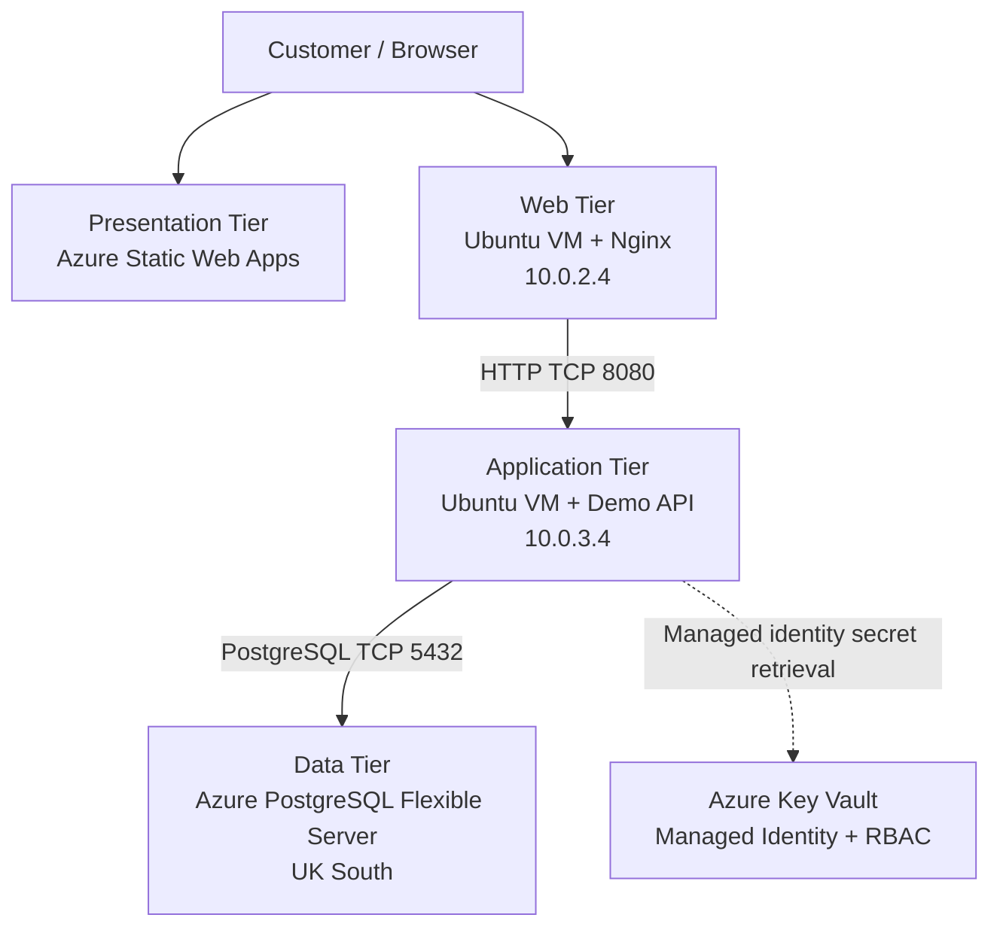

# High-Availability Retail Platform on Azure

A cloud engineering project demonstrating how to design, deploy, secure, and validate a three-tier retail platform using Microsoft Azure, Terraform, Linux virtual machines, managed identities, Azure Key Vault, and Azure Database for PostgreSQL.

**Project status:** Core infrastructure is deployed. The demo API is running on the application VM, web-to-application HTTP connectivity is verified, PostgreSQL authentication and a database write test succeeded, and managed-identity access to Key Vault is verified. Full retail application integration and high availability remain in progress.

## 1. Project Overview

This project demonstrates a three-tier architecture that separates presentation, application logic, and persistent data.

The objectives are to practise:

- Infrastructure as Code with Terraform.
- Network segmentation and private connectivity.
- Linux VM administration and Nginx configuration.
- Application API deployment and troubleshooting.
- Azure managed identities and Key Vault.
- PostgreSQL authentication and database operations.
- GitHub Actions and source control.
- Security validation, monitoring, and cost management.

## 2. Architecture

### Three-tier design



The diagram represents the intended architecture and the validated connections. The API currently returns hardcoded demo products; full retail application integration is not yet complete.

### Tier responsibilities

| Tier | Responsibility | Implementation |
|---|---|---|
| Presentation | Deliver the storefront | Azure Static Web Apps and a separate Nginx web VM |
| Application | Handle API requests and business logic | Ubuntu application VM running a Python demo API |
| Data | Store persistent application data | Azure Database for PostgreSQL Flexible Server |

Azure Key Vault supports the architecture by storing secrets and controlling access through Azure RBAC and managed identity.

### South India deployment

- Virtual network: `ha-retail-vnet` (`10.0.0.0/16`)
- Web subnet: `10.0.2.0/24`
- Application subnet: `10.0.3.0/24`
- Reserved subnet: `10.0.1.0/24` for a potential Application Gateway
- Web VM: `ha-retail-southindia-web-vm` (`10.0.2.4`)
- Application VM: `ha-retail-southindia-app-vm` (`10.0.3.4`)
- Key Vault: `hrkv6952055559284c2ca73a`

Both VMs use Ubuntu 22.04, SSH key authentication, and no public IP addresses.

### UK South database deployment

- PostgreSQL server: `ha-retail-southindia-pg`
- Resource group: `ha-retail-southindia-postgresql-uksouth`
- Database virtual network: `ha-retail-southindia-postgresql-vnet`
- Database virtual network address space: `10.1.0.0/16`
- Delegated database subnet: `10.1.1.0/24`
- Private IP observed during validation: `10.1.1.4`
- Database: `retaildb`
- Application database login: `retailapp`

VNet peering and private DNS provide the network path from the application environment to PostgreSQL. The database uses delegated-subnet networking, not a Private Endpoint.

## 3. Why Three-Tier Architecture?

### Benefits

- **Separation of concerns:** Presentation, business logic, and data have distinct responsibilities.
- **Security boundaries:** Each tier can have separate network and identity permissions.
- **Independent scaling:** Components can be scaled according to their workloads.
- **Maintainability:** Each component can be updated and diagnosed separately.
- **Fault isolation:** Network, API, and database issues can be investigated independently.
- **Least privilege:** Components can receive only the permissions they require.

### Trade-offs

Three-tier architecture introduces additional infrastructure cost, network dependencies, DNS configuration, and operational complexity.

Separating components does not automatically provide high availability. Redundancy, health checks, traffic distribution, backup and recovery, and tested failover are also necessary.

## 4. Application Tier

The application VM runs a Python demo API as a systemd service.

- Application directory: `/opt/ha-retail-api/`
- Application source on the VM: `/opt/ha-retail-api/app.py`
- systemd service: `ha-retail-api.service`
- Application port: TCP `8080`
- Health endpoint: `/health`
- Product endpoint: `/api/products`

The health endpoint returns a healthy status, and the product endpoint returns demo product data.

The web VM has successfully accessed the API over the private network at `http://10.0.3.4:8080`.

**Current limitation:** The demo API returns hardcoded products. It has not yet been connected to PostgreSQL, and its source and deployment procedure still need to be added to the Git repository for reproducible deployment.

## 5. Network and Security Decisions

### Network segmentation

The web and application VMs occupy separate subnets. The application NSG allows TCP 8080 ingress from the web subnet (`10.0.2.0/24`).

The intended web-to-application HTTP path has been tested successfully.

### Managed identity and Azure Key Vault

The application VM uses a system-assigned managed identity to authenticate to Key Vault without requiring a stored Azure service-principal secret.

Verified configuration:

- Azure RBAC authorization is enabled on the vault.
- The application VM identity has the `Key Vault Secrets User` role at vault scope.
- The Key Vault firewall default action is `Deny`.
- The application subnet is allowed through a virtual network rule.
- The `Microsoft.KeyVault` service endpoint is enabled on the application subnet.
- Managed-identity secret retrieval succeeded without printing secret values.
- The temporary `Key Vault Secrets Officer` role assignment used during setup was removed and verified absent.
- No temporary public IP firewall rules remained in the final verification.
- Purge protection is enabled on the vault.

**Network design note:** Key Vault uses a public endpoint protected by firewall rules and a virtual network service endpoint. A Private Endpoint has not been deployed.

The diagnostic tests confirm managed-identity access to Key Vault. The retail application has not yet been integrated with Key Vault for application-level secret retrieval.

### PostgreSQL private connectivity

PostgreSQL Flexible Server is deployed in UK South with public access disabled.

Verified:

- The database hostname resolves to its private IP from the application environment.
- TCP port `5432` is reachable from the application VM.
- The `retaildb` database exists.
- The dedicated `retailapp` login can authenticate using the password retrieved from Key Vault.
- A test table was successfully created and dropped in the `app` schema.

The PostgreSQL administrator password was reset after temporary credential handling during setup. The application database login uses its separate password stored in Key Vault.

The application API is not yet integrated with PostgreSQL.

## 6. Infrastructure as Code

Terraform configuration in `terraform-southindia/` manages the current South India infrastructure deployment.

The repository also contains an earlier `terraform/` directory.

Before running Terraform commands:

1. Confirm the correct working directory.
2. Confirm the Azure subscription and target resources.
3. Review backend and state configuration.
4. Run `terraform plan` and inspect the proposed changes.
5. Apply only after verifying the plan.

Do not assume the two Terraform directories share state or manage identical resources.

## 7. Technology Stack

| Area | Technology |
|---|---|
| Cloud platform | Microsoft Azure |
| Infrastructure as Code | Terraform |
| Compute | Ubuntu 22.04 Linux VMs |
| Web server | Nginx |
| Application API | Python standard-library HTTP server |
| Presentation hosting | Azure Static Web Apps |
| Database | Azure Database for PostgreSQL Flexible Server |
| Secrets management | Azure Key Vault |
| Identity and authorization | Managed identity and Azure RBAC |
| Network security | VNets, subnets, NSGs, service endpoints, VNet peering, private DNS |
| Source control | Git and GitHub |
| Delivery automation | GitHub Actions |
| Troubleshooting | Azure CLI, Linux tools, HTTP, TCP, and SQL checks |

## 8. Validation Evidence

| Validation | Result |
|---|---|
| Terraform deployment of documented infrastructure | Completed for deployed resources |
| Nginx local HTTP response | HTTP 200 verified |
| App VM to web VM HTTP request | HTTP 200 verified |
| Web VM to application VM | Demo API HTTP response verified |
| Application health endpoint | Healthy response verified |
| Application product endpoint | Demo product JSON returned |
| PostgreSQL hostname resolution | Private IP resolution verified |
| Application VM to PostgreSQL TCP 5432 | Reachability verified |
| PostgreSQL authentication using `retailapp` | Successful |
| Database test table create/drop | Successful |
| Application VM managed identity token acquisition | Verified |
| Key Vault secret retrieval | Successful without printing secret values |
| Key Vault firewall default-deny | Verified |
| Temporary Key Vault Secrets Officer assignment cleanup | Verified |
| Temporary Key Vault IP rule cleanup | Verified |
| PostgreSQL administrator password reset | Completed |
| Demo API integration with PostgreSQL | Pending |
| Retail application integration with Key Vault | Pending |
| Full storefront-to-database request flow | Pending |
| Application Gateway and high-availability traffic distribution | Not implemented |

These checks validate individual infrastructure and service behaviors. They do not establish that the complete retail application is operational.

## 9. Current Limitations and Next Steps

1. **Make API deployment reproducible:** Add the demo API source and deployment instructions to the repository.
2. **Connect the API to PostgreSQL:** Replace hardcoded product data with database-backed operations.
3. **Integrate Key Vault:** Retrieve the required application secret through managed identity without logging its value.
4. **Validate application behavior:** Test the API against the database using the dedicated `retailapp` login.
5. **Complete the retail request flow:** Demonstrate the storefront/web-to-application-to-database path.
6. **Implement high availability:** Evaluate Application Gateway, backend redundancy, health probes, and failure handling.
7. **Add monitoring and recovery:** Define alerts, backup requirements, recovery expectations, and operational checks.
8. **Improve CI/CD:** Add automated application deployment and tests where appropriate.
9. **Manage costs:** Review running resources and stop or deallocate eligible compute when it is not needed.

## 10. Repository Structure

```text
ha-retail-project/
├── .github/
│   └── workflows/
├── docs/
│   ├── PROGRESS.md
│   └── architecture-decisions.md
├── terraform/
├── terraform-southindia/
├── website/
└── README.md
```

The API currently deployed on the VM is not yet represented in this repository structure. Adding its source and deployment configuration is a planned improvement.

## 11. Cost and Security Considerations

- VM compute, managed database capacity, storage, and networking may incur charges.
- Deallocated VMs can continue to incur disk and other resource charges.
- A stopped database may continue to incur storage and related charges.
- Keep SSH access restricted and use SSH keys.
- Never commit credentials, secret values, private keys, or sensitive Terraform state.
- Prefer managed identity and narrowly scoped RBAC permissions.
- Do not print secrets in application logs or troubleshooting output.
- Review Key Vault firewall rules and role assignments after security changes.
- Rotate credentials promptly if they are exposed or temporarily staged.
- Verify resource states before assuming that services have stopped.

## 12. Project Summary

This project establishes a three-tier Azure architecture with separate web and application subnets, a private cross-region PostgreSQL database, Terraform-managed infrastructure, and managed-identity-based Key Vault access.

The demo API is running, web-to-application connectivity is verified, and database authentication and write operations have succeeded.

The remaining work is to connect the API to PostgreSQL, integrate application-level secret retrieval, make deployment reproducible from source control, and implement and test the redundancy and recovery measures required before claiming high availability.

Repository: https://github.com/varuganti-pavan-kumar/ha-retail-project
