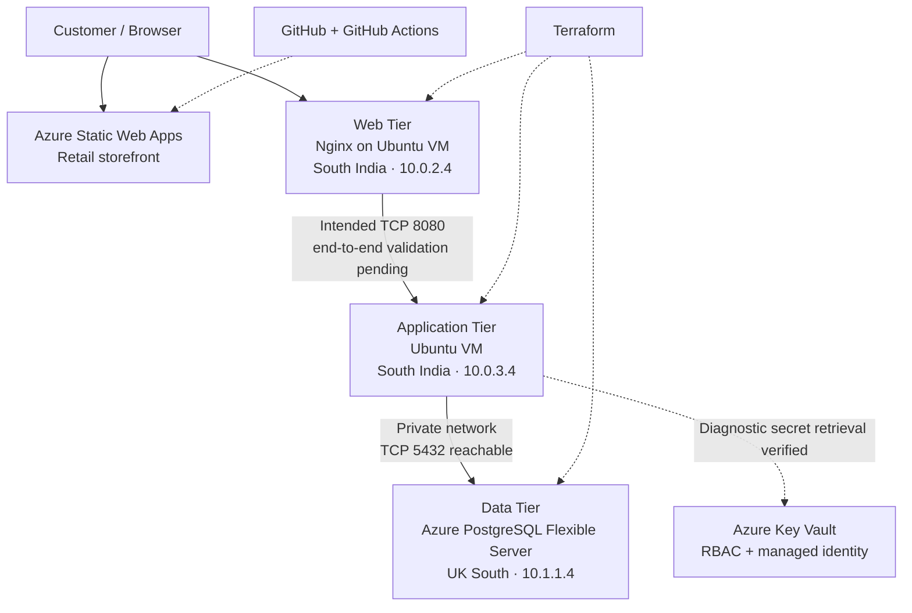

# Architecture Decisions — Azure Three-Tier Retail Platform

**Last updated:** 25 October 2026

## 1. Purpose

This document records the architecture decisions for the Azure retail platform, including the rationale, alternatives, trade-offs, and validation evidence.

The target architecture separates presentation, application logic, and persistent data into three tiers. Supporting Azure services provide infrastructure automation, network controls, identity-based authorization, secrets management, and delivery automation.

A decision being documented does not necessarily mean its full implementation or end-to-end behavior has been verified. Each decision includes its current implementation status where relevant.

## 2. Architecture Overview

### Target architecture

The diagram shows the target request path and the supporting infrastructure. It does not assert that the complete retail application flow is operational.

### Deployed network layout

**South India**

- Virtual network: `ha-retail-vnet`
- Address space: `10.0.0.0/16`
- Reserved Application Gateway subnet: `10.0.1.0/24`
- Web subnet: `10.0.2.0/24`
- Application subnet: `10.0.3.0/24`
- Web VM: `ha-retail-southindia-web-vm`, `10.0.2.4`
- Application VM: `ha-retail-southindia-app-vm`, `10.0.3.4`

**UK South**

- Database virtual network: `ha-retail-southindia-postgresql-vnet`
- Address space: `10.1.0.0/16`
- Delegated database subnet: `10.1.1.0/24`
- PostgreSQL server: `ha-retail-southindia-pg`
- Private IP observed during validation: `10.1.1.4`

VNet peering and private DNS provide the intended cross-region connectivity between the application environment and PostgreSQL.

## 3. Core Decision: Three-Tier Architecture

**Status:** Adopted as the target architecture; end-to-end application integration remains incomplete.

### Context

Combining presentation, application logic, and database responsibilities on one server can simplify an initial deployment, but it couples the components and makes network isolation, independent scaling, and troubleshooting more difficult.

The project needs to demonstrate the design and validation of realistic cloud infrastructure, not simply the deployment of a single VM.

### Decision

Separate the platform into three logical tiers:

1. **Presentation tier:** Serves the retail interface and handles incoming user-facing requests.
2. **Application tier:** Hosts business logic and mediates access to application data.
3. **Data tier:** Stores persistent retail data in PostgreSQL.

The current implementation uses Azure Static Web Apps for the storefront, a separate Nginx web VM, an application VM, and Azure Database for PostgreSQL Flexible Server.

### Rationale

- Establishes clear responsibilities and network boundaries.
- Allows different access policies to be applied to each tier.
- Supports independent resource sizing and potential scaling.
- Makes troubleshooting easier by isolating presentation, application, and database failures.
- Provides a foundation for future redundancy and availability improvements.

### Alternatives considered

**Single-tier deployment:** Put the web server, application, and database on one machine.

- Advantage: Fewer resources and less initial configuration.
- Disadvantage: Greater coupling, weaker separation of access boundaries, and limited independent scaling.

**Two-tier deployment:** Combine the web and application responsibilities or combine application and data responsibilities.

- Advantage: Potentially lower infrastructure and operational overhead.
- Disadvantage: Less separation between responsibilities and fewer opportunities to practise distinct tier-level network controls.

### Trade-offs

Three tiers introduce additional infrastructure cost, network dependencies, DNS requirements, and operational complexity. They do not guarantee high availability by themselves. Redundancy, health checks, traffic management, recovery procedures, and tested failover are still required.

## 4. Decision: Separate Web and Application Subnets

**Status:** Implemented; intended web-to-application traffic validation pending.

### Context

The web-facing component and the application workload have different network access requirements. The application service should not need unrestricted access from arbitrary sources.

### Decision

Use separate subnets within `ha-retail-vnet`:

- Web: `10.0.2.0/24`
- Application: `10.0.3.0/24`

Configure the application network security group to allow inbound TCP 8080 from the web subnet.

### Rationale

- Limits application-tier ingress to the intended web network.
- Establishes a clear trust boundary between the web and application workloads.
- Makes network policy easier to review and troubleshoot.
- Reduces unnecessary exposure compared with broad inbound rules.

### Alternatives considered

**Single shared subnet:** Simpler addressing and fewer subnet-level distinctions, but less explicit separation of tier network boundaries.

**Broad application ingress:** Easier to test initially, but permits unnecessary sources and weakens the intended security policy.

### Validation and limitations

An HTTP request from the application VM to the web VM returned HTTP 200. This is evidence of application-to-web connectivity only; it does not prove web-to-application connectivity.

The next step is to confirm that an application service is listening on TCP 8080 and then test the intended direction from the web VM.

## 5. Decision: Use Azure Database for PostgreSQL Flexible Server

**Status:** Database deployed; network validation passed; authentication and query validation pending.

### Context

The retail platform requires persistent relational storage. The database should be separate from the application compute and should not be exposed directly to public clients.

### Decision

Deploy Azure Database for PostgreSQL Flexible Server in UK South, using a delegated subnet in a separate virtual network. Connect the South India application environment through VNet peering and private DNS.

### Rationale

- Separates database administration and persistence from application compute.
- Uses a managed database service instead of requiring the project to administer a PostgreSQL server on a VM.
- Avoids public database access for the deployed configuration.
- Provides an opportunity to validate private DNS and cross-region network connectivity.

### Alternatives considered

**PostgreSQL on a VM:** Offers more operating-system and database-level control, but requires more responsibility for maintenance, patching, backups, and availability.

**Public database endpoint:** May simplify initial connectivity but would increase exposure and conflict with the project's private-networking objective.

**Private Endpoint:** Provides a different private connectivity model, but it was not the approach deployed for the current database.

### Validation

- Database hostname resolves to private IP `10.1.1.4` from the application environment.
- TCP port 5432 is reachable from that environment.
- PostgreSQL authentication and an SQL query have not yet been verified.

Private DNS resolution and TCP reachability do not establish that the database credentials or SQL operations work.

## 6. Decision: Terraform for Infrastructure as Code

**Status:** Adopted; current deployment configuration maintained in `terraform-southindia/`.

### Context

Manual portal-based deployment alone is difficult to reproduce and review. Infrastructure changes need to be recorded and applied consistently.

### Decision

Use Terraform to define and reconcile Azure infrastructure, with the current South India deployment configuration maintained in `terraform-southindia/`.

### Rationale

- Makes infrastructure definitions reviewable in source control.
- Supports repeatable deployment and change planning.
- Helps identify configuration drift.
- Provides a consistent record of resource configuration and dependencies.

### Alternatives considered

**Manual Azure portal deployment:** Useful for exploration and troubleshooting, but less reproducible and harder to review systematically.

**Azure Bicep:** A strong Azure-native alternative with first-class Azure resource support. Terraform was selected for this project to practise Terraform-based infrastructure management.

### Operational safeguards

The repository contains both `terraform/` and `terraform-southindia/`. Before applying changes:

1. Confirm the correct working directory.
2. Confirm the Azure subscription and target resources.
3. Inspect the Terraform backend and state configuration.
4. Run `terraform plan` and review proposed changes.
5. Apply only after confirming the plan targets the intended environment.

Do not assume the two Terraform directories share the same state or manage identical resources.

## 7. Decision: Managed Identity and Key Vault for Secrets

**Status:** Identity-based diagnostic secret retrieval verified; application integration pending.

### Context

Embedding credentials in application source, scripts, or configuration files creates risks of accidental disclosure and difficult credential rotation.

### Decision

Use Azure Key Vault for secret storage and the application VM's system-assigned managed identity for authentication.

The application VM has the `Key Vault Secrets User` role at vault scope. Azure RBAC authorizes secret access.

### Network design

The vault uses a public endpoint protected by firewall rules:

- Firewall default action: `Deny`.
- Application subnet allowed through a virtual network rule.
- `Microsoft.KeyVault` service endpoint enabled on the application subnet.
- Public network access remains enabled at the service level, with the firewall restricting permitted network access.
- A Private Endpoint is not deployed.

### Rationale

- Avoids storing an Azure client secret on the VM solely to authenticate to Key Vault.
- Provides a centralized place to manage application secrets.
- Separates network access controls from identity-based authorization.
- Allows access to be restricted to the required identity and vault permissions.

### Alternatives considered

**Hard-coded secret:** Simple initially but risks disclosure and makes rotation harder.

**Stored service-principal credentials:** Can support automation, but require the credentials themselves to be protected and rotated.

**Private Endpoint:** An alternative for private IP-based connectivity to Key Vault. It was not selected for the current implementation; the deployed design uses a service endpoint and Key Vault firewall.

### Validation evidence

On 25 October 2026:

- The application VM acquired a managed identity token.
- A diagnostic operation retrieved the `connectivity-test` secret.
- The request returned HTTP 200 and `SECRET_RETRIEVAL=SUCCESS`.
- The test validated the expected result without printing the secret value.
- The temporary `Key Vault Secrets Officer` role assignment was removed and checked in the subsequent role listing.

The temporary assignment's removal was verified. The remaining role listing showed the inherited subscription `Owner` role and the application's `Key Vault Secrets User` role.

### Limitations

The diagnostic test proves identity-based secret retrieval from the VM, not that the retail application consumes the secret. Application integration and application-level error handling remain pending.

## 8. Decision: Cross-Region Network Connectivity

**Status:** VNet peering and database connectivity checks verified; full database operation pending.

### Context

The application workloads are deployed in South India, while the PostgreSQL server is deployed in UK South. The application needs a network path to the database without exposing the database to public clients.

### Decision

Use VNet peering between the South India and UK South networks, with private DNS configured for database hostname resolution.

### Rationale

- Provides private network connectivity between the environments.
- Allows the application to use the database hostname rather than relying on a hard-coded IP address.
- Demonstrates cross-region network design and DNS troubleshooting.

### Trade-offs

Cross-region networking introduces additional latency and networking costs compared with co-locating the application and database. It also introduces dependencies on peering, DNS, routing, and firewall configuration.

### Validation

Database hostname resolution and TCP 5432 reachability have been confirmed from the application environment. Authentication, SQL execution, application integration, and performance measurements remain outstanding.

## 9. Decision: Azure Static Web Apps and GitHub Actions

**Status:** Storefront hosting and existing delivery workflow established.

### Context

The storefront should be deliverable from source control without requiring every frontend release to be tied to a VM configuration change.

### Decision

Maintain storefront source in `website/`, host it on Azure Static Web Apps, and use GitHub Actions for the existing delivery workflow.

### Rationale

- Separates static storefront delivery from VM-based infrastructure.
- Supports source-controlled changes and automated deployment.
- Reduces the need to serve all static assets directly from a VM.

### Trade-offs and limitations

The hosted storefront and Nginx web VM are separate presentation-related components. Their intended relationship with the application tier still needs end-to-end validation.

Static Web Apps hosting and a working delivery workflow do not, by themselves, demonstrate that the backend request flow is operational.

## 10. Decision: Defer High-Availability Claims Until Validated

**Status:** High availability not yet implemented end to end.

### Context

The project is intended to demonstrate a highly available retail platform, but the current infrastructure does not yet prove redundant application serving or tested failover.

### Decision

Treat high availability as a future implementation milestone rather than a completed property of the current deployment.

A future design should evaluate:

- Application Gateway or another suitable traffic-distribution mechanism.
- Multiple appropriate backend instances or other required redundancy.
- Health probes and backend health management.
- Failure scenarios and recovery behavior.
- Database backup and recovery objectives.
- Monitoring and alerting.

### Rationale

A three-tier architecture separates responsibilities, but three tiers alone do not ensure that any tier can survive a failure. Availability claims need evidence from the deployed topology and tests.

### Current limitation

The subnet `10.0.1.0/24` is reserved for a potential Application Gateway. An Application Gateway has not been deployed as part of the current validated state.

## 11. Validation Record

| Area | Observed result | Remaining work |
|---|---|---|
| Web server | Nginx returned HTTP 200 locally | Verify complete request path |
| VM network path | App VM → web VM returned HTTP 200 | Verify web VM → app VM |
| Application service | TCP 8080 ingress rule configured | Confirm service listener and HTTP response |
| Database DNS | Private IP resolution verified | Test authenticated connection |
| Database network | TCP 5432 reachable | Execute SQL query |
| Key Vault identity | Secret retrieval succeeded | Integrate with application |
| Key Vault network | Default-deny and subnet rule verified | Continue periodic access review |
| Terraform | Current infrastructure configuration deployed | Maintain safe plan/apply workflow |
| Storefront CI/CD | Existing delivery workflow established | Validate end-to-end application integration |
| High availability | Not implemented end to end | Deploy and test redundancy and failover |

## 12. Security and Operational Principles

- Use least-privilege RBAC roles and review inherited permissions as well as direct assignments.
- Keep database public access disabled unless a reviewed architectural change requires otherwise.
- Restrict tier-to-tier traffic to the sources and ports required.
- Avoid committing credentials, private keys, secret values, or sensitive Terraform state.
- Do not print secrets in logs or diagnostic output.
- Validate both identity authorization and network reachability when troubleshooting access.
- Review Terraform plans before applying infrastructure changes.
- Monitor resource state and cost; stopping or deallocating compute does not necessarily eliminate all associated charges.
- Distinguish successful infrastructure checks from successful application behavior.

## 13. Outstanding Decisions and Work

1. Confirm the application framework and deploy a service that listens on the intended application port.
2. Validate web-to-application traffic and record the result.
3. Test PostgreSQL authentication and SQL execution.
4. Integrate application secret retrieval with Key Vault managed identity.
5. Demonstrate an end-to-end retail request.
6. Select and implement the appropriate high-availability topology.
7. Define monitoring, backup, recovery, and failover tests.
8. Revisit cross-region placement and latency/cost trade-offs after measuring application behavior.

## Conclusion

The current design establishes a three-tier Azure architecture with separate web and application subnets, a privately networked cross-region PostgreSQL database, Terraform-managed infrastructure, and identity-based Key Vault access.

The architecture choices are intended to improve separation of concerns, network security, maintainability, and future scalability. The remaining work is to validate application behavior across the tiers and implement the redundancy and recovery measures required before describing the platform as fully operational and highly available.